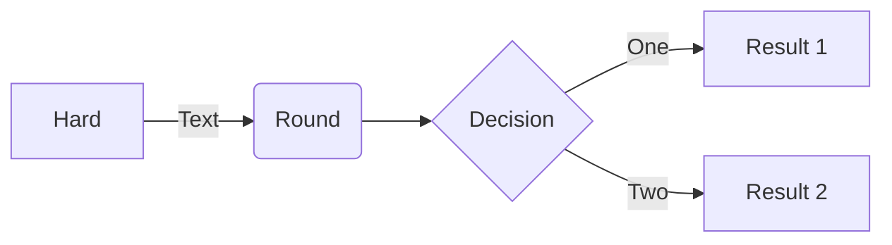
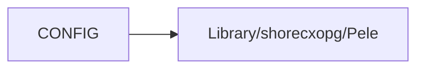

This library renders ` ```mermaid ` code blocks with [Pele](https://pele.run), a fast Mermaid renderer, instead of Mermaid.js.



* **Works offline.** Pele is bundled into the plug, and SilverBullet syncs plugs to every device. Nothing is fetched from a CDN.
* **Only loads when needed.** SilverBullet starts a plug when one of its functions is first used, so Pele is loaded the first time a page with a diagram is shown, not on every start.
* **Follows your theme.** Diagrams use your editor's colors and switch between light and dark mode with it.
* **Fits the editor.** A diagram that's wider than the editor is laid out again for the space there is. On a phone, a wide flowchart turns vertical.

# Use
Put Mermaid in a fenced code block and move the cursor out of it:

    ```mermaid
    sequenceDiagram
      Alice->>Bob: Hello Bob!
      Bob-->>Alice: Hi Alice!
    ```

Click a diagram to edit its source. All of Mermaid's diagram types are supported.

## Links
`click` links open in a new tab. Nodes with the `internal-link` class link to the page named by their label, and a `click` link without a URL scheme opens that page:



# Configuration
Every setting is optional. Set them in [[CONFIG]], then reload:

```lua
config.set("pele", {
  -- Label font. Use a font installed on your device or a generic family
  -- such as "sans-serif" or "serif": labels are measured off-screen, where
  -- fonts loaded by web pages aren't available.
  fontFamily = "sans-serif",
  fontFamilyMono = "monospace",
  fontSize = 16,
  -- Lay diagrams out again when they're wider than the editor.
  adaptive = true,
  -- Clickable links in diagrams.
  links = true,
  -- Images in diagrams. These load from the network when shown.
  images = true,
  -- Default Mermaid configuration. A diagram's frontmatter overrides it.
  mermaid = { flowchart = { curve = "linear" } },
  -- Extra CSS for diagrams, for example to change Pele's theme variables:
  -- https://pele.run/theming
  css = ".pele { --pele-accent: #b4232f; }",
})
```

# Notes
* This replaces the [silverbullet-mermaid](https://github.com/silverbulletmd/silverbullet-mermaid) plug; remove that one. Also remove the `Library/silverbullet-diagram/Mermaid` library if you have it: Space Lua code widgets take precedence over plugs, so its renderer would be used instead.
* Pele has its own layout and style, so diagrams don't look exactly like Mermaid.js's. See [Compatibility](https://pele.run/compatibility).
* Font Awesome and Iconify icons (`fa:fa-car`, `logos:aws`) aren't bundled, and `$$math$$` is shown as TeX.
