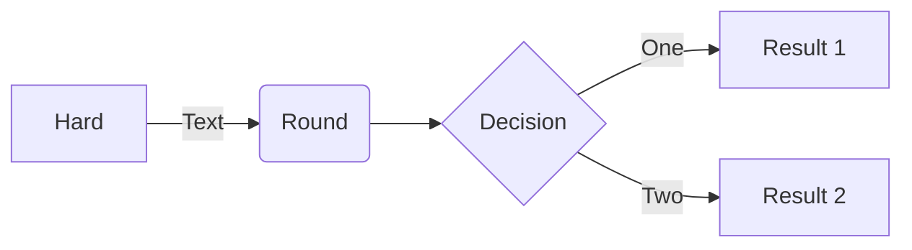

# Pele for SilverBullet

A [SilverBullet](https://silverbullet.md) plug that renders ` ```mermaid ` code blocks with [Pele](https://pele.run) instead of Mermaid.js. Existing Mermaid blocks keep working, including offline.



## Offline, without loading it on every start

[silverbullet-mermaid](https://github.com/silverbulletmd/silverbullet-mermaid) loads Mermaid.js from a CDN, so that the 1.1 MB library is only loaded on pages with diagrams. The cost is that diagrams need an internet connection. This plug bundles Pele into the plug file, but still loads it only when a diagram is shown:

1. **Pele runs inside the plug's Web Worker.** Unlike Mermaid.js, Pele renders synchronously and never touches the DOM. It measures labels with an `OffscreenCanvas`, which workers have, so the whole render happens in the plug's background thread. The diagram's iframe gets finished SVG and a few kilobytes of script. The library itself is never loaded into the page or into each diagram's iframe.
2. **SilverBullet syncs `.plug.js` files to every device**, even with `sync.documents` off, so the bundled Pele is available offline. A separate `.js` file next to the plug would only sync if documents do.
3. **SilverBullet starts plug workers lazily.** It caches each plug's manifest and starts a plug's worker the first time one of its functions is called. This plug has no hooks besides the code widget: no events, commands or startup work. Its worker, and Pele with it, starts when the first diagram is shown and is reused for the rest of the session. (After you install or update the plug, SilverBullet starts it once to read the new manifest.)

The cost is the plug's size: `pele.plug.js` is 731 KB (274 KB gzipped), synced once per device per plug version. Pele itself accounts for 98% of that.

## Install

Run the `Library: Install` command (or open `Libraries: Manager` and choose Install) and enter:

```
github:shorecxopg/silverbullet-pele/PLUG.md
```

This installs the `Library/shorecxopg/Pele` page with `pele.plug.js` next to it.

To install by hand, copy [`pele.plug.js`](pele.plug.js) anywhere into your space and run `Plugs: Reload`.

If you use [silverbullet-mermaid](https://github.com/silverbulletmd/silverbullet-mermaid), remove it, since both handle ` ```mermaid ` blocks. Also remove `Library/silverbullet-diagram/Mermaid` if you have it: code widgets defined in Space Lua take precedence over plugs.

## Use

Write Mermaid in a fenced code block and move the cursor out of it to see the diagram. Click the diagram to edit it again. Pele supports [every diagram type built into Mermaid 12.1](https://pele.run/compatibility), with its own layout and visual style.

- **Theme:** diagrams use your editor's colors, including colors from [Space Style](https://silverbullet.md/Space%20Style) and the background of blockquotes. They switch between light and dark mode with the editor, without re-rendering.
- **Width:** a diagram that's wider than the editor is laid out again for the space there is. Below 640 pixels, a wide flowchart turns vertical.
- **Links:** `click` links to websites open in a new tab. Nodes with the `internal-link` class link to the page named by their label, and a `click` target without a URL scheme, like `click A "Some Page"`, opens that page.
- **Errors** show Pele's message with the line and column.

## Configure

Every setting is optional. Set them in your `CONFIG` page, then reload:

```lua
config.set("pele", {
  -- Label font. Use a font installed on the device or a generic family such
  -- as "sans-serif", "serif" or "system-ui". Labels are measured in the
  -- plug's worker, where fonts loaded by web pages aren't available.
  fontFamily = "sans-serif",
  fontFamilyMono = "monospace",
  fontSize = 16,
  -- Lay diagrams out again when they're wider than the editor.
  adaptive = true,
  -- Clickable links in diagrams.
  links = true,
  -- Images in diagrams. These load from the network when shown.
  images = true,
  -- Default Mermaid configuration. A diagram's frontmatter overrides it.
  mermaid = { flowchart = { curve = "linear" } },
  -- Extra CSS for the diagram frame, for example Pele's theme variables:
  -- https://pele.run/theming
  css = ".pele { --pele-accent: #b4232f; }",
})
```

Set the font with `fontFamily`, not with `--pele-font` in `css`: Pele sizes nodes using the font it measured.

## Limitations

- Font Awesome and Iconify icons (`fa:fa-car`, `logos:aws`) aren't bundled, so they're not shown. `$$math$$` is shown as TeX.
- Diagrams are laid out by Pele, not Mermaid.js, so positions and spacing differ. See [Pele's compatibility notes](https://pele.run/compatibility).

## Develop

```sh
npm install
npm run build      # builds pele.plug.js
npm test           # unit tests
npm run test:e2e   # end-to-end tests in Chromium (needs Playwright)
```

`npm run build` runs SilverBullet's `plug-compile` and then appends the licenses of the bundled code to `pele.plug.js`. Commit the built `pele.plug.js`, since `Library: Install` downloads it from this repository.

The end-to-end tests load the built plug with SilverBullet's own plug runtime from [`@silverbulletmd/silverbullet`](https://www.npmjs.com/package/@silverbulletmd/silverbullet): the same `System`, `WorkerSandbox`, manifest cache and code widget hook the SilverBullet client uses. They render into SilverBullet's widget iframe document (see [`test/harness`](test/harness)). They check that the worker isn't started until a diagram is shown, that nothing is requested from the network, and that rendering, theming, links, errors and resizing work. Install Playwright with `npm i -D playwright && npx playwright install chromium`, and set `SHOTS=<dir>` to save screenshots.

To update Pele, change its version in `package.json`, then run `npm install`, `npm run build` and the tests.

| File | Runs in |
| --- | --- |
| [`src/widget.ts`](src/widget.ts) | The plug's worker. The code widget and the function the iframe calls to re-render for another width. |
| [`src/render.ts`](src/render.ts) | The plug's worker. Calls Pele. |
| [`src/html.ts`](src/html.ts) | The plug's worker. Builds the iframe's HTML and theme CSS. |
| [`src/frame.ts`](src/frame.ts) | The diagram's iframe. Follows the editor theme, handles clicks and links, and keeps the size in step. |

## License

`pele.plug.js` bundles [Pele](https://github.com/obsidianmd/pele) (MIT) and SilverBullet's plug runtime (MIT). Their notices are at the end of the file and in [THIRD_PARTY_NOTICES.md](THIRD_PARTY_NOTICES.md).
